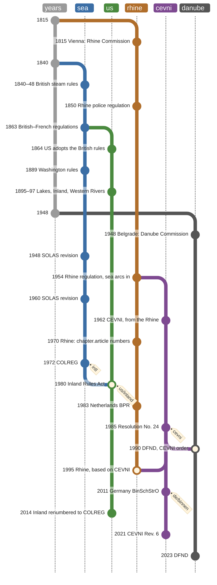

# Where the rules come from

Three bodies of collision and navigation rules meet in this package: the
international sea rules (COLREG), the United States rules, and the European
inland-waterway rules of the Rhine, the Danube and UNECE's CEVNI. This page
says where each came from and how they relate, so that a reader can choose a
jurisdiction, read a citation, and see why the United States inland rules are
a restatement of the Convention while the European inland rules are not.
Editions and national lag per jurisdiction are in
[`docs/timeline.md`](timeline.md).

## Three traditions

**The sea rules** begin as British steamship practice: Trinity House steering
rules in 1840, an Act in 1846, and in 1848 the Admiralty's lights for steamers,
a white masthead light with green starboard and red port sidelights. The
Board of Trade rewrote them with the French government in 1863, and by the end
of 1864 more than thirty states had adopted them. The Washington conference of
1889 produced the set that came into force in 1897; SOLAS conferences revised
it in 1948 and 1960, when the light arcs were restated in degrees. The 1972
Convention reordered the rules, conduct before lights and sound, and moved
technical detail into annexes. Seven amendments since have added paragraphs
and a Part; none has renumbered a rule.

**The United States** took the same stem. The 1864 Act adopted the British
rules, lights articles first and arcs in compass points. From 1885 the
international rules governed the high seas while inland waters split three
ways: the Great Lakes Rules of 1895, the Inland Rules and Pilot Rules of 1897,
and the Western Rivers rules left over from 1864. The Inland Navigational Rules
Act of 1980 reunified them as "special rules" under COLREG Rule 1(b), in the
Convention's own Parts A to E and Rules 1 to 38, with annexes "as consistent
as possible" with the Convention's. The Coast Guard moved them into 33 CFR
Part 83 in 2010 and aligned their numbering and format with COLREG in 2014.
That is why `us/inland` is a delta: the instrument restates the Convention
paragraph for paragraph and states only its differences.

**European inland navigation** has a different stem: river commissions. The
Congress of Vienna created the Central Commission for the Rhine in 1815; the
first Rhine police regulation dates from 1850 and the Mannheim Act of 1868 is
still the Commission's foundation. The Danube came under an international
regime in 1856 and under the Danube Commission in 1948. UNECE's inland
transport body took up harmonisation in 1956, first adopted CEVNI in 1962, and
replaced it with Resolution No. 24 in 1985, which asks national rules to keep
CEVNI's "existing order and numbering of the chapters". The Commission for the
Rhine says the code "was largely inspired by" its own regulation, and its 1995
regulation is in turn "based on" CEVNI. Germany, the Netherlands, the Moselle
and the Danube have followed the same pattern. The European Union's inland
directives concern technical requirements for vessels, not navigation rules.

## What is shared, and what is not

The light arcs, 225° masthead, 112°30' sidelights, 135° sternlight, and the
one, two and three short blasts are common to all three bodies, and they were
in the Rhine regulation of 1954 before CEVNI existed. CEVNI's second revision
named the Convention twice, in a footnote on sound signals and in accepting
COLREG-standard lights; its fifth and sixth do not name it at all. CEVNI keeps
marking and sound signals ahead of the rules of the road, the order the sea
rules had before 1972. Read article by article against the Convention (the
authors' own count of CEVNI Rev. 6, 146 articles), CEVNI states the same
provision in a tenth of its articles, an analogue with different parameters
in a fifth, and in the rest things the Convention has nothing on: locks,
waterway signs, berthing, reporting, the blue board, blue cones, upstream and
downstream. Whether CEVNI's chapter-and-article numbering came from the Rhine
or went to it is not settled: the Rhine text of 1954 does not have it and the
text of 1970 does, and CEVNI's 1962 text has not been read.

## The lineage as a timeline

One lane per tradition, top to bottom; a lane leaves another where a text
derives from it and joins another where a text takes the other in. Spacing is
by event, not by year. The sea rules' light arcs and sound signals reached the
Rhine by 1954 at the latest, a borrowing the graph cannot draw.

## Chronology

Every row was read on the source page (verified) or is given as the named
secondary source states it (cited). Nothing recalled from memory is here.

| Year | Tradition | Event | Source | Confidence |
|---|---|---|---|---|
| 1815 | Rhine | Appendix 16 B to the Final Act of the Congress of Vienna creates the Central Commission for the Rhine; art. 110 wants police control "as much as possible" uniform along the river | [CCNR history][ccnr-h], [Collinson 1972][collinson] | verified / cited |
| 1831 | Rhine | Mainz Convention, 31 March | [CCNR history][ccnr-h] | verified |
| 1838 | US | Steamboat Act (5 Stat. 304): steamboats running between sunset and sunrise carry signal lights | [govinfo][us1838] | verified |
| 1840 | sea | Trinity House regulations: steamers in a narrow channel keep the other on the port hand; crossing steamers alter to starboard | [Cockcroft][cockcroft] | cited |
| 1846 | sea | Steam Navigation Act enacts the Trinity House steering rule and empowers the Admiralty to regulate lights | [Bahr][bahr], [Cockcroft][cockcroft] | cited |
| 1848 | sea | Admiralty lights for steamers in operation from July: white masthead, green starboard, red port | [Bahr][bahr], [Cockcroft][cockcroft] | cited |
| 1850 | Rhine | First Rhine police regulation (Protocol No. VIII) | [CCNR regulations][ccnr-r] | verified |
| 1852 | US | Steamboat Act (10 Stat. 61): Board of Supervising Inspectors; inspectors set rules for vessels passing each other | [govinfo][us1852] | verified |
| 1856 | Danube | Treaty of Paris puts the Danube under an international regime; European Commission of the Danube | [International Water Law][iwl] | cited |
| 1858 | sea | Coloured sidelights extended to sailing vessels; fog signals required | [Cockcroft][cockcroft] | cited |
| 1863 | sea | Board of Trade rules drawn up with the French government come into operation; adopted by more than thirty states by the end of 1864 | [Cockcroft][cockcroft] | cited |
| 1864 | US | Act of 29 April (13 Stat. 58) adopts the British rules, in force 1 September; lights articles precede steering; arcs in compass points | [govinfo][us1864] | verified |
| 1868 | Rhine | Mannheim Act, 17 October: the Commission's legal foundation to this day | [CCNR history][ccnr-h] | verified |
| 1880–84 | sea | 1880: whistle signals for action taken; 1884: a new set of 27 articles | [Cockcroft][cockcroft] | cited |
| 1885 | US | Act of 3 March (23 Stat. 438) adopts the revised international regulations for the high seas and coast waters; the 1864 rules continue elsewhere | [33 U.S.C. ch. 5 notes][usc33] | verified |
| 1889 | sea | International Marine Conference, Washington: the stand-on vessel keeps speed as well as course; optional second masthead light | [Cockcroft][cockcroft] | cited |
| 1890 | US | Act of 19 August (26 Stat. 320) carries the Washington rules into US law | [33 U.S.C. ch. 5 notes][usc33] | verified |
| 1895 | US | Great Lakes Rules (28 Stat. 645); the 1864 rules become special rules for other inland waters (28 Stat. 672) | [33 U.S.C. ch. 5 notes][usc33] | verified |
| 1897 | sea | Washington regulations brought into force by the UK, the US and others | [Cockcroft][cockcroft] | cited |
| 1897 | US | Inland Rules (30 Stat. 96); supervising inspectors' passing rules become the Pilot Rules | [govinfo][us1897] | verified |
| 1897 | US | The 1864 rules thereafter govern only the Red River of the North and rivers emptying into the Gulf of Mexico: the Western Rivers rules | [33 U.S.C. ch. 5 notes][usc33] | verified |
| 1910 | sea | Brussels Collision Convention, 23 September: liability and apportionment of fault, not rules of the road | [Admiralty Law Guide][brussels] | verified |
| 1910 | sea | Regulations slightly changed from Washington's, in force until 1954 | [Cockcroft][cockcroft] | cited |
| 1921 | Danube | Definitive Statute of the Danube, Paris, 23 July | [Danube Commission][dc-conv] | verified |
| 1929 | sea | SOLAS conference proposes minor changes, never ratified; direct-sense helm orders in force 1933 | [Cockcroft][cockcroft] | cited |
| 1940 | US | Motorboat Act, 25 April, lights for motorboats; repealed by the 1980 Act | [govinfo][us1980] | verified |
| 1947 | UNECE | Inland Transport Committee set up | [CEVNI Rev. 5][cevni5] | verified |
| 1948 | sea | SOLAS conference revises the rules: second masthead light compulsory from 150 ft, sternlight, optional five-short-blast signal | [Cockcroft][cockcroft] | cited |
| 1948 | US | Western Rivers rules revised (62 Stat. 249), effective 1 January 1949 | [33 U.S.C. ch. 5 notes][usc33] | verified |
| 1948 | Danube | Belgrade Convention, 18 August, in force 11 May 1949: the Commission lays down "the basic provisions governing navigation"; national rules take them into account | [Danube Commission][dc-conv] | verified |
| 1951 | Danube | The Commission adopts basic rules on rafting, pilotage and damage inquiry; Yugoslavia objects | [Denver Law Review][denver] | cited |
| 1954 | sea | 1948 regulations in force 1 January (US Proclamation 3030) | [govinfo][us1954] | verified |
| 1954 | Rhine | Rhine police regulation of 3 March (in force 1 January 1955): sequential sections; a Part I for the whole river; masthead 225°, sidelights 112°30' green and red; one, two and three short blasts; long blast 4–6 s | [BGBl. 1954 II][rh1954] | verified |
| 1954 | Germany | First BinSchStrO, 19 December, in force 1 January 1955 | [Wikipedia (de)][binsch-wp] | cited |
| 1956 | Moselle | Moselle Convention, 27 October (DE, FR, LU); Moselle Commission from 1962 | [Sénat report 1983][moselle] | cited |
| 1956 | UNECE | The Committee creates the Sub-Committee on Inland Water Transport, later SC.3 | [CEVNI Rev. 5][cevni5], [CEVNI Rev. 6][cevni6] | verified |
| 1957 | UNECE | Resolution No. 1, 28 August: standardised signalling on inland waterways | [SIGNI Rev. 2][signi2] | verified |
| 1960 | sea | Collision Regulations 1960, SOLAS conference, London; in force 1 September 1965; arcs stated in degrees | [Proclamation 3632][proc3632] | verified |
| 1962 | UNECE | CEVNI first adopted, by Resolution No. 4 of the Sub-Committee (TRANS/270, annex 1) | [CEVNI Rev. 6][cevni6] | verified |
| 1966 | Germany | BinSchStrO of 11 October (BGBl. II S. 1333) | [BGBl. 1970 I][rh1970] | verified |
| 1967 | Danube | First DFND the current text names, 25th session, 9 June | [DFND 2018][dfnd2018] | verified |
| 1970 | Rhine | Rhine police regulation 1970: chapter-and-article numbering in use (§ 1.22, § 4.01, § 6.33, § 7.09) | [BGBl. 1970 I][rh1970], [Swiss compilation][ch-rh] | verified |
| 1972 | sea | COLREG adopted 20 October, in force 15 July 1977; Rule 10 makes traffic separation schemes mandatory | [IMO][imo] | verified |
| 1972 | sea | The conference reorders the rules: conduct before lights, shapes and sound; technical detail to annexes | [Cockcroft][cockcroft] | cited |
| 1977 | US | International Navigational Rules Act (Pub. L. 95-75) adopts COLREG | [govinfo][us1977] | verified |
| 1980 | US | Inland Navigational Rules Act (Pub. L. 96-591), 24 December: "to unify the rules"; Parts A–E, Rules 1–38; "special rules" under COLREG Rule 1(b); annexes "as consistent as possible" with the Convention's; repeals the 1864, 1890, 1895, 1897 and 1940 rules | [govinfo][us1980] | verified |
| 1981 | US | Inland Rules in effect 24 December | [govinfo][us1980] | verified |
| 1981–2013 | sea | Seven COLREG amendments; none renumbers a rule | [IMO][imo-amd], [`docs/timeline.md`](timeline.md) | verified |
| 1982 | UNECE | Resolution No. 22 (SIGNI), 12 November, harmonising inland signs with the IALA maritime buoyage system | [SIGNI Rev. 2][signi2] | verified |
| 1983 | Rhine | Rhine police regulation 1983, in force 1 October | [Swiss compilation][ch-rh] | verified |
| 1983 | US | Inland Rules in effect on the Great Lakes, 1 March | [Federal Register 1983][fr1983] | verified |
| 1983 | Netherlands | BPR, decree of 26 October (Stb. 1983, 682), in force 1 April 1984, drafted from the Rhine regulation | [wetten.overheid.nl][bpr], [Stb. 2015, 395][bpr-stb] | verified |
| 1985 | UNECE | Resolution No. 24, 15 November, replaces the CEVNI text; national rules in two parts, keeping "the existing order and numbering of the chapters" | [CEVNI Rev. 2][cevni2] | verified |
| 1990 | Danube | New DFND, 25 April, in force 1 October 1991: two-part national rules keeping its chapter order, numbering and titles | [DFND 2018][dfnd2018] | verified |
| 1995 | Rhine | Rhine police regulation 1995, in force 1 January, the current base text; "based on" CEVNI and SIGNI | [gesetze-im-internet][rh1995], [CCNR integration study][ccnr-int] | verified / cited |
| 1997 | Moselle | Moselle police regulation, 3 September | [gesetze-im-internet][mosel] | cited |
| 1998 | UNECE | CEVNI Rev. 1 | [CEVNI Rev. 6][cevni6] | verified |
| 2000 | UNECE | CEVNI Rev. 2 (published 2002): a footnote cites COLREG Rule 34; Annex 5 permits COLREG-standard lights | [CEVNI Rev. 2][cevni2] | verified |
| 2004 | US | Coast Guard and Maritime Transportation Act lets the Secretary issue the Inland Rules by regulation | [79 FR 37898][fr2014] | verified |
| 2006 | UNECE | CEVNI Rev. 3 | [CEVNI Rev. 6][cevni6] | verified |
| 2006 | EU | Directive 2006/87/EC, technical requirements for inland vessels, not navigation rules | [legislation.gov.uk][eu2006] | verified |
| 2008 | UNECE | CEVNI Rev. 4 (published 2009) | [CEVNI Rev. 6][cevni6] | verified |
| 2010 | US | Inland Rules moved from the U.S. Code into 33 CFR Part 83 (75 FR 19544) | [79 FR 37898][fr2014] | verified |
| 2010 | UNECE | SIGNI Rev. 2 by Resolution No. 67, aligned with CEVNI Rev. 4 | [SIGNI Rev. 2][signi2] | verified |
| 2010 | Danube | New DFND, 14 December, in force 1 January 2012, "taking into account" CEVNI Rev. 4 | [DFND 2018][dfnd2018] | verified |
| 2011 | Germany | BinSchStrO of 16 December, in force 1 February 2012; section and annex numbering follows Resolution No. 24, with empty slots kept | [BinSchStrO PDF][binsch2011] | verified |
| 2014 | UNECE | CEVNI Rev. 5 by Resolution No. 81 (published 2015); light specifications moved to Resolution No. 61; no reference to COLREG in the text | [CEVNI Rev. 5][cevni5] | verified |
| 2014 | US | 79 FR 37898, effective 1 August: Inland Rules numbering and format aligned with COLREG, "very similar in both content and format" | [79 FR 37898][fr2014] | verified |
| 2016 | EU | Directive (EU) 2016/1629, technical requirements by reference to ES-TRIN; silent on navigation rules | [legislation.gov.uk][eu2016] | verified |
| 2018 | Danube | New DFND, 29 June, in force 1 July 2019, taking into account CEVNI Rev. 5 | [DFND 2018][dfnd2018] | verified |
| 2021 | UNECE | CEVNI Rev. 6 by Resolution No. 102, November, prepared with the Rhine, Danube, Moselle and Sava commissions | [CEVNI Rev. 6][cevni6], [UNECE (archived)][unece-r6] | verified |
| 2023 | Danube | DFND 2023 edition | [Danube Commission][dc-dfnd] | verified |
| 2025 | UNECE | CEVNI Rev. 6, Amendment 1, 17 April | [UNECE][unece-a1] | cited |

## What this means for the data

- `intl` is the Convention, with its paragraph grammar: `23(a)(i)`.
- `us/inland` is a delta over `intl` because the 1980 Act made the Inland
  Rules a restatement ([ADR 0018](adr/0018-jurisdiction-delta-is-a-merge-patch.md)).
  A national text that adopts the Convention, as the United Kingdom's does,
  takes the same shape.
- `cevni` is the second root, with its own stem and its own paragraph
  grammar: `3.08(1)`. The Rhine, Moselle, Danube and German texts are deltas
  over it, because Resolution No. 24 asks them to keep CEVNI's numbering.
- Correspondence between the two roots is a relation on the row, never
  inheritance: a tenth of CEVNI is the same provision, a fifth an analogue.
- A CEVNI citation is the path with the edition beside it, because the code
  renumbers between revisions; the Convention has never renumbered a rule.

## Sources

[ccnr-h]: https://www.ccr-zkr.org/11010100-en.html
[ccnr-r]: https://www.ccr-zkr.org/12020100-en.html
[ccnr-int]: https://www.ccr-zkr.org/files/histoireCCNR/17_the-integration-of-european-waterways.pdf
[collinson]: https://www.ccr-zkr.org/files/histoireCCNR/03_the-rhine-regime-in-transition.pdf
[cockcroft]: https://maritimesafetyinnovationlab.org/wp-content/uploads/2020/10/History_of_the_Collision_Regulations.pdf
[bahr]: https://research-repository.st-andrews.ac.uk/handle/10023/14084
[us1838]: https://www.govinfo.gov/link/statute/5/304
[us1852]: https://www.govinfo.gov/link/statute/10/61
[us1864]: https://www.govinfo.gov/link/statute/13/59
[us1897]: https://www.govinfo.gov/link/statute/30/96
[us1954]: https://www.govinfo.gov/content/pkg/STATUTE-79/pdf/STATUTE-79-Pg1454.pdf
[us1977]: https://www.govinfo.gov/content/pkg/STATUTE-91/pdf/STATUTE-91-Pg308.pdf
[us1980]: https://www.govinfo.gov/content/pkg/STATUTE-94/pdf/STATUTE-94-Pg3415.pdf
[usc33]: https://tile.loc.gov/storage-services/service/ll/uscode/uscode1976-00903/uscode1976-009033005/uscode1976-009033005.pdf
[proc3632]: https://www.govinfo.gov/content/pkg/STATUTE-79/pdf/STATUTE-79-Pg1454.pdf
[brussels]: https://admiraltylawguide.com/conven/collisions1910.html
[iwl]: https://www.internationalwaterlaw.org/cases/ec-danube.html
[dc-conv]: https://www.danubecommission.org/dc/en/danube-commission/convention-regarding-the-regime-of-navigation-on-the-danube/
[dc-dfnd]: https://www.danubecommission.org/dc/en/danube-navigation/basic-provisions-for-navigation-on-the-danube-dfnd/
[dfnd2018]: https://www.danubecommission.org/uploads/doc/2018/DFND_2018_ru.pdf
[denver]: https://digitalcommons.du.edu/cgi/viewcontent.cgi?article=3904&context=dlr
[rh1954]: https://www.bgbl.de/
[rh1970]: https://media.offenegesetze.de/bgbl1/1970/bgbl1_1970_87.pdf
[rh1995]: https://www.gesetze-im-internet.de/rheinschpev_1994/BJNR238160994.html
[ch-rh]: https://www.fedlex.admin.ch/
[mosel]: https://www.gesetze-im-internet.de/moselschpv_1997/
[moselle]: https://conferenceconsensuslogement.senat.fr/rap/1983-1984/i1983_1984_0279.pdf
[binsch-wp]: https://de.wikipedia.org/wiki/Binnenschifffahrtsstra%C3%9Fen-Ordnung
[binsch2011]: https://www.gesetze-im-internet.de/binschstro_2012/BinSchStrO.pdf
[bpr]: https://wetten.overheid.nl/BWBR0003628/2026-06-17/0/informatie
[bpr-stb]: https://zoek.officielebekendmakingen.nl/stb-2015-395.html
[cevni2]: https://media.voog.com/0000/0041/3078/files/CEVNI%20TRANS-SC3-115r2e.pdf
[cevni5]: https://web.archive.org/web/2022id_/https://www.unece.org/fileadmin/DAM/trans/doc/finaldocs/sc3/ECE-TRANS-SC3-115-Rev.5e_WEB.pdf
[cevni6]: https://waterways.cz/documents/European_Code_for_Inland_Waterways_E.pdf
[signi2]: https://web.archive.org/web/2020id_/https://www.unece.org/fileadmin/DAM/trans/doc/2011/sc3wp3/ECE-TRANS-SC3-108r2e_01.pdf
[unece-r6]: https://web.archive.org/web/2024id_/https://unece.org/transport/publications/cevni-european-code-inland-waterways-rev6
[unece-a1]: https://unece.org/transport/documents/2025/04/standards/cevni-european-code-inland-waterways-resolution-no-24
[imo]: https://www.imo.org/en/About/Conventions/Pages/COLREG.aspx
[imo-amd]: https://www.imo.org/en/ourwork/safety/pages/preventing-collisions.aspx
[fr1983]: https://archives.federalregister.gov/issue_slice/1983/7/5/30616-30623.pdf
[fr2014]: https://www.govinfo.gov/content/pkg/FR-2014-07-02/html/2014-14413.htm
[eu2006]: https://www.legislation.gov.uk/eudr/2006/87/introduction
[eu2016]: https://www.legislation.gov.uk/eudr/2016/1629/introduction
